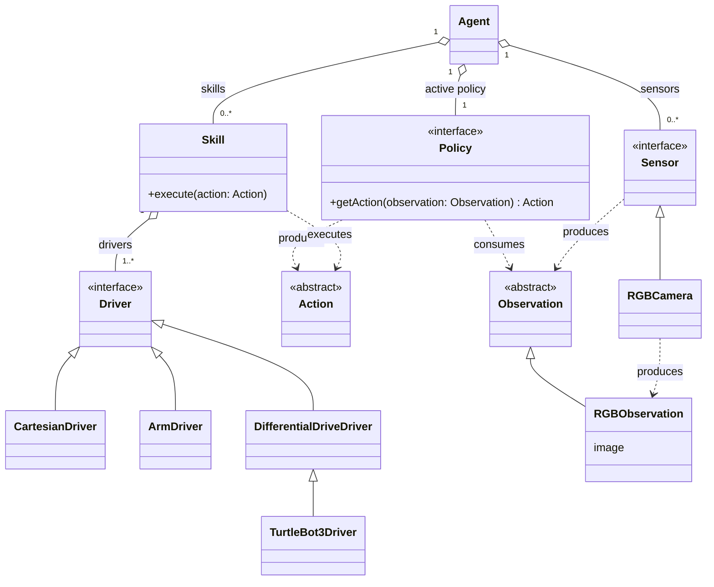
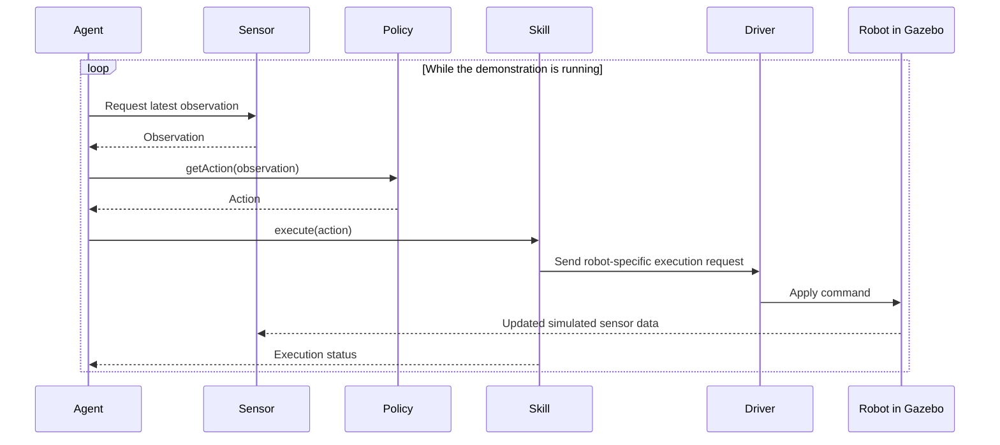

# Robot Agent Architecture

> Architecture, MVP, and POC reconstructed from the supplied whiteboard photograph. UML diagrams use Mermaid and render in Markdown viewers with Mermaid support.

## 1. Project overview

Build a modular robot-control architecture that separates decision-making, executable skills, robot drivers, and sensing. The same core interfaces should support different robots and policies.

The whiteboard identifies two demonstrations, in this order:

1. **MVP:** A TurtleBot3 performs a dance in Gazebo using the new architecture.
2. **POC:** A simulated UR-series arm performs pick and place in Gazebo, after the MVP.

**Source fidelity:** The core classes and demonstration goals come from the photograph. Interface types, execution details, and acceptance criteria below are proposed clarifications, not requirements explicitly written on the board. The arm label appears to read **UR5e**, but the handwriting is ambiguous; confirm the exact model before implementation. Some small action and implementation labels are also unclear and are not transcribed as confirmed names.

## 2. UML class diagram

This diagram captures the main relationships on the board. Method signatures are normalized for readability. The board shows one Agent aggregating multiple Skills and Sensors; the single active Policy and the Skill-to-Driver multiplicity below are interpretations to confirm.

**UML notation:** A hollow diamond (`o--`) denotes aggregation, a hollow triangle (`<|--`) denotes inheritance or interface specialization, and a dashed arrow (`..>`) denotes a dependency. Multiplicities describe how many instances participate in a relationship.

The board also sketches several interchangeable Policy and Action implementations. These can extend the interfaces above without changing the Agent structure. Their exact names and contracts remain to be confirmed.

## 3. Component responsibilities

| Component | Responsibility | Example |
| --- | --- | --- |
| **Agent** | Coordinates sensing, policy evaluation, and skill execution. | A configured controller for one simulated robot. |
| **Sensor** | Acquires data and exposes it through an Observation. | An RGB camera. |
| **Observation** | Carries the input used by a Policy. | An RGB image; the board gives 640 × 480 as an example. |
| **Policy** | Chooses an Action from the available Observation. | A scripted dance policy for the MVP. |
| **Action** | Represents the requested behavior independently of transport details. | A proposed timed base movement or arm pose target. |
| **Skill** | Executes a supported Action using the appropriate Driver or Drivers. | Base motion, reaching, or grasping. |
| **Driver** | Translates execution requests into robot-specific commands. | A TurtleBot3 differential-drive adapter or an arm adapter. |

The distinction between Policy and Skill is central: the Policy decides **what to do**, and the Skill handles **how to execute it** through robot-specific Drivers.

### Proposed control cycle

The following sequence makes the whiteboard's dependencies concrete. Polling, dispatch, and completion reporting are proposed execution semantics.

For a scripted demonstration, a Policy may ignore the Observation. Its interface can remain compatible with future policies that use sensor feedback.

## 4. MVP — TurtleBot3 dance in Gazebo

**MVP means Minimum Viable Product:** the smallest integrated version that delivers the intended behavior and allows the architecture to be evaluated end to end.

For this project, the MVP is a **TurtleBot3 performing a dance in Gazebo through the new architecture**. Its purpose is to establish that the Agent, Policy, Action, Skill, and Driver components work together in a running simulation.

### Proposed minimum scope

- One simulated TurtleBot3 in a simple Gazebo world.
- One Agent with a deterministic, scripted dance Policy.
- A small set of base-motion Actions, such as driving forward, rotating, and stopping.
- A motion Skill backed by a TurtleBot3 differential-drive Driver.
- A defined start, completion condition, and stop behavior.
- Enough logging to trace each chosen Action to its execution result.

### Example demonstration

1. Start Gazebo and initialize the Agent.
2. Execute a short, predefined sequence of translations and rotations.
3. Complete the sequence and command the robot to stop.
4. Reset the demonstration and run it again.

The precise choreography, velocities, and durations are implementation choices; they are not specified in the photograph.

### Proposed acceptance criteria

- The robot completes the configured dance in simulation.
- Dance commands pass through **Policy → Action → Skill → Driver**.
- The Policy contains no robot transport or simulator command code.
- The robot stops at completion and when the demonstration is cancelled.
- The same configuration can run the demonstration again after a reset.

**Outside the proposed MVP scope:** manipulation, learned policies, physical hardware deployment, and perception-dependent tasks. Camera integration can be included to exercise the Sensor interface, but image-based decision-making is unnecessary for a scripted dance.

## 5. POC — UR-series pick and place in Gazebo

**POC means Proof of Concept:** a focused experiment that tests whether a particular technical idea is feasible.

For this project, the POC is **pick and place with a simulated UR-series arm in Gazebo**. It tests whether the architecture established by the TurtleBot3 MVP can support manipulation by adding suitable Actions, Skills, and Drivers.

Although a POC often precedes an MVP in other projects, the whiteboard explicitly places this POC **after the MVP**. Here, it serves as a second demonstration of the architecture's extensibility.

### Proposed minimum scope

- One simulated UR-series arm, with the exact model confirmed before setup.
- A compatible simulated gripper or another explicitly defined grasp mechanism.
- One object with a known initial pose and a fixed placement target.
- A deterministic manipulation Policy.
- Manipulation Actions and Skills for approaching, grasping, lifting, moving, and releasing.
- An arm Driver and, if needed, a separate gripper Driver.

Known object poses keep the first experiment focused on manipulation and architecture reuse. Camera-based object localization is a possible follow-up, not a confirmed whiteboard requirement.

### Example demonstration

1. Initialize the arm and open the gripper.
2. Move to a pre-grasp pose above the object.
3. Approach the object and close the gripper.
4. Lift the object clear of the surface.
5. Move to the placement pose.
6. Lower and release the object, then retreat.

### Proposed acceptance criteria

- The arm picks up the object and releases it in a defined target region.
- Both demonstrations retain the same core Agent, Policy, Skill, Action, Driver, Sensor, and Observation abstractions.
- Arm- and gripper-specific commands remain inside their execution adapters.
- The run reports completion or failure, including a failed grasp or an unreachable target.
- The task can be repeated after resetting the scene.

The target tolerance and required number of successful repeat runs should be agreed before evaluating the POC.

## 6. MVP and POC comparison

| Aspect | MVP | POC |
| --- | --- | --- |
| Main question | Can the architecture run a complete robot behavior? | Can the architecture extend to manipulation? |
| Robot | TurtleBot3 | UR-series arm; model to confirm |
| Environment | Gazebo | Gazebo |
| Behavior | Dance | Pick and place |
| Main execution adapter | Differential-drive Driver | Arm and gripper Drivers |
| Initial Policy | Proposed scripted sequence | Proposed scripted sequence |
| Completion evidence | Dance completes and robot stops | Object is transferred to the target region |
| Order on the board | First | After the MVP |

## 7. Open design decisions

- **Robot model:** Confirm whether the handwritten arm model is UR5e.
- **Action contracts:** Define payloads, units, coordinate frames, and supported Action types for each Skill.
- **Execution lifecycle:** Decide whether `execute` blocks until completion or returns a task handle, and define cancellation and failure reporting.
- **Policy configuration:** Confirm whether an Agent holds exactly one active Policy or supports switching among several.
- **Skill and Driver ownership:** Confirm whether Drivers are owned by individual Skills or shared across them.
- **Sensing:** Define how multiple Sensor outputs are combined and how missing or stale observations are handled.
- **Runtime integration:** The side sketch appears to show ROS 2 between a VM and a Raspberry Pi. Confirm its intended role; it is not included in the minimum simulation scope above.
- **Simulation setup:** Select compatible Gazebo, robot model, and middleware versions before implementation.
